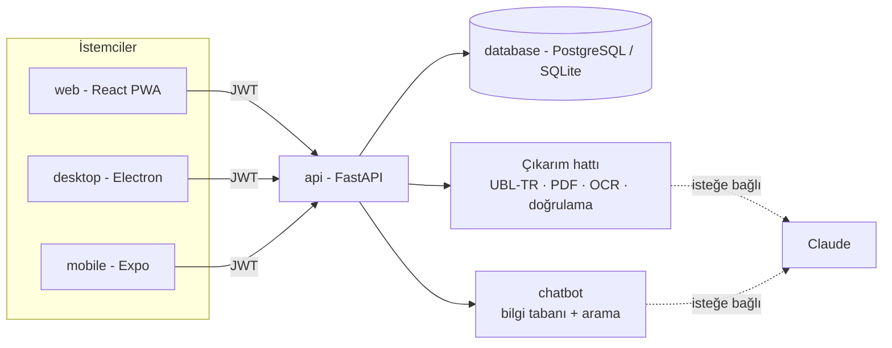

# Fatura Okuyucu

**Fatura ve fişleri okuyup muhasebeye hazır veriye çeviren, web, masaüstü ve mobil istemcili sistem.**

Müşteri telefonuyla fişi çeker. Muhasebeci aynı hesapla web veya masaüstünde şüpheli alanları inceler, düzeltir, onaylar ve
Excel/CSV olarak alır. Uygulamada bir şeyi bulamayan kullanıcıya yardım asistanı yolu tarif eder ve onu doğrudan ilgili ekrana götürür.


## Özellikler

- **Çok biçimli okuma:** e-Fatura/e-Arşiv **UBL-TR XML**, **PDF** (metin katmanı), taranmış PDF ve **fotoğraf** (yerel OCR).
- **Doğrulama:** VKN/TCKN sağlama toplamı, matrah + KDV = toplam, KDV oranı, tarih makullüğü, aynı faturanın tekrarı.
  Güvensiz okuma sessizce geçmez, **"incelemede"** olur.
- **İki rol:** *müşteri* (belge yükler, yalnızca kendininkini görür) ve *muhasebeci* (büronun tüm belgelerini inceler, düzeltir, onaylar, dışa aktarır).
- **Ortak hesap:** telefonda çekilen fiş, web ve masaüstünde anında görünür.
- **Yardım asistanı:** "dışa aktarma nerede?" diye sorana yolu anlatır, adımları listeler, tek dokunuşla ekrana götürür.
- **Gizlilik varsayılanı yerel:** belgeler dışarı gönderilmez; yapay zeka (Claude) yalnızca açıkça `hybrid` mod açılırsa devreye girer.
- **KVKK:** dosyalar süre sonunda otomatik silinir, belge işlemleri denetim günlüğüne yazılır.

## Mimari



| Klasör | Açıklama | Branch | Test |
|---|---|---|---|
| [`database/`](database) | PostgreSQL şeması, docker-compose, saklama süresi sorgusu | `database` | - |
| [`api/`](api) | Kimlik, belge yükleme, çıkarım, doğrulama, onay, dışa aktarma, ölçüm betiği | `api` | 124 |
| [`chatbot/`](chatbot) | Yardım asistanı: bilgi tabanı, arama, rol/istemci kuralları, isteğe bağlı Claude | `chatbot` | 81 |
| [`web/`](web) | React + TypeScript arayüzü, PWA, kamera ile yükleme | `web` | 7 |
| [`desktop/`](desktop) | Electron uygulaması (web'in aynı derlemesi, sıkı güvenlik) | `desktop` | 4 |
| [`mobile/`](mobile) | Expo / React Native: kamera, liste, asistan | `mobile` | 8 |

Her bileşen kendi branch'inde geliştirildi ve `main`'de birleştirildi.

## Teknolojiler

| Katman | Kullanılanlar |
|---|---|
| Arka uç | Python, FastAPI, SQLAlchemy, Pydantic, PyJWT, pypdf, openpyxl |
| Okuma | UBL-TR XML ayrıştırıcı, kural tabanlı Türkçe metin çözümleyici, RapidOCR (yerel, isteğe bağlı) |
| Veritabanı | PostgreSQL (üretim), SQLite (geliştirme/test) |
| Web | React 18, TypeScript, Vite, React Router, PWA |
| Masaüstü | Electron (sandbox, contextIsolation) |
| Mobil | Expo SDK 52, React Native, React Navigation, SecureStore |
| Asistan | Türkçe normalizasyon + IDF tabanlı arama, isteğe bağlı Claude |

## Hızlı başlangıç

```bash
cp .env.example .env            # JWT_SECRET'i rastgele bir değerle değiştir
cd api && pip install -r requirements.txt && uvicorn app.main:app --port 8000
cd web && npm install && npm run dev                      # http://localhost:5173
cd desktop && npm install && npm start                    # önce: cd web && npm run build
cd mobile && npm install --legacy-peer-deps && npx expo start
```

İlk kullanım: muhasebeci olarak kayıt ol (büro adı gir), **"Büro ve Davet Kodu"** ekranındaki kodu müşteriye ver,
müşteri bu kodla kayıt olur. Ayrıntılar her klasörün kendi README'sinde.

## Ne ölçüldü, ne ölçülmedi

Rakamların hepsi yeniden üretilebilir; sınırları da açıkça yazıldı.

| Konu | Sonuç | Sınır |
|---|---|---|
| Çıkarım doğruluğu (PDF/XML, sentetik, 318 belge) | Tüm alanlar %100 | Şablonlar çözümleyiciyle birlikte yazıldı; **gerçek faturalarda daha düşük olacaktır** |
| Hata yakalama (bilerek bozulmuş 82 belge) | %100 incelemeye düştü, 0 yanlış alarm | Sentetik veri |
| OCR hattı (temiz render, yerel OCR) | %67 tam doğru, kalanı incelemeye işaretli, **0 sessiz hata** | Gerçek telefon fotoğraflarında düşer |
| Asistan, hiç görmediği 25 soru (yerel mod) | %40 doğru, %52 "anlayamadım + öneri", %8 yanlış | Kelime tabanlı arama; farklı ağızda zayıf |
| Claude destekli modlar (çıkarım, asistan) | **Canlı API anahtarıyla denenmedi** | Yalnızca sahte istemciyle test edildi |
| Web arayüzü | Gerçek API ile tarayıcıda elle denendi: giriş, düzeltme, onay, asistan yönlendirmesi, dışa aktarma | Otomatik arayüz testi yok |
| Masaüstü | Gerçek Electron'da açıldı, Node sızıntısı yok, dış gezinti engellendi, API'ye ulaştı | Yükleyici üretilmedi |
| Mobil | TypeScript, birim testleri, `expo-doctor` 18/18 | **Telefonda/emülatörde çalıştırılmadı** |

Ölçümü yenilemek: `cd api && python -m eval.run_eval --n 400 --ocr` ve `python -m chatbot.eval_heldout -v`.

## Tasarım kararları

- **Doğrulama merkezde:** okuma hatası sessizce geçmesin diye her alan kurallardan geçer; şüpheli olan "incelemede" olur.
- **Güven, sorunlardan anlık türetilir:** kalıcı kayıtta çıkarıcının ham skoru durur; muhasebeci bir alanı düzeltince sorun kalkar ve
  diğer alanların güveni kendiliğinden toparlanır.
- **Roller sunucuda zorlanır:** müşteri yalnızca kendi belgelerini görür, büro verileri `org_id` ile izole edilir (testli).
  Asistan da rolü istekten değil oturumdan alır.
- **Güvenlik:** PBKDF2 şifre özeti, giriş denemesi sınırı, yüklemede uzantı + magic-byte kontrolü, XML `DOCTYPE` reddi,
  dışa aktarmada formül enjeksiyonu koruması, sıkı CSP, Electron sandbox, mobilde Keychain/Keystore.

## Gizli bilgiler

Anahtarlar, şifreler ve veritabanı bilgileri **repoda yoktur**. [`.env.example`](.env.example) yalnızca örnektir; gerçek değerler
`.env` dosyasına yazılır ve `.gitignore` ile dışarıda tutulur. Commit'lerde kişisel e-posta yerine GitHub noreply adresi kullanılmıştır.

## Bilinen eksikler / yol haritası

- Gerçek, anonimleştirilmiş belgelerle ölçüm ve çözümleyiciyi buna göre geliştirme
- Kalem (satır) bazlı okuma; Logo/Mikro/Luca'ya özel dışa aktarma şablonları
- Şifre sıfırlama/değiştirme, e-posta doğrulama
- Asistanda anlamsal arama (gömme) veya ölçülmüş `hybrid` mod
- Çok sunuculu kurulum için ortak oran sınırlayıcı (Redis), Alembic ile veritabanı geçişleri
- Docker dosyaları (`api/Dockerfile`, `database/docker-compose.yml`) bu ortamda derlenip denenmedi
