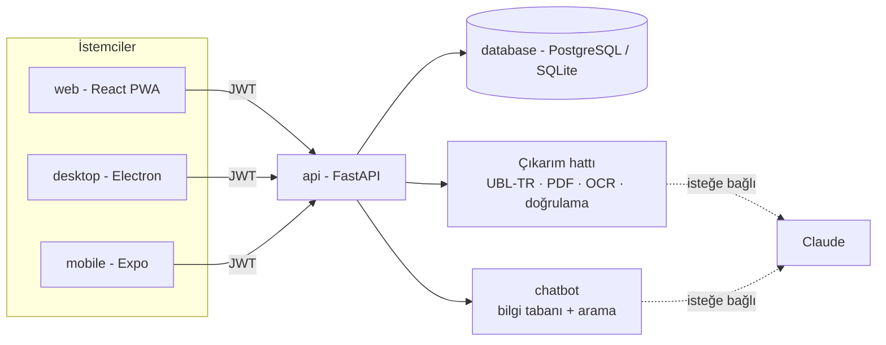

# Fatura Okuyucu

Muhasebe büroları ve müşterileri için fatura/fiş okuyup yapılandırılmış veriye çeviren, çok istemcili (web, masaüstü, mobil) sistem.
Müşteri telefonuyla fişi çeker; muhasebeci aynı hesapla web veya masaüstünde şüpheli alanları inceler, düzeltir, onaylar ve Excel/CSV olarak alır.
Uygulamada bir şeyi bulamayan kullanıcıya yardım asistanı yolu tarif eder ve onu ilgili ekrana götürür.



| Klasör | Açıklama | Branch | Test |
|---|---|---|---|
| [`database/`](database) | PostgreSQL şeması, docker-compose, saklama süresi sorgusu | `database` | - |
| [`api/`](api) | Kimlik, belge yükleme, çıkarım, doğrulama, onay, dışa aktarma, ölçüm betiği | `api` | 124 |
| [`chatbot/`](chatbot) | Yardım asistanı: bilgi tabanı, arama, rol/istemci kuralları, isteğe bağlı Claude | `chatbot` | 81 |
| [`web/`](web) | React + TypeScript arayüzü, PWA, kamera ile yükleme | `web` | 7 |
| [`desktop/`](desktop) | Electron uygulaması (web'in aynı derlemesi, sıkı güvenlik) | `desktop` | 4 |
| [`mobile/`](mobile) | Expo / React Native: kamera, liste, asistan | `mobile` | 8 |

Her bileşen kendi branch'inde geliştirildi ve `main`'de birleştirildi.

## Hızlı başlangıç

```bash
cp .env.example .env            # JWT_SECRET'i rastgele bir değerle değiştir (README: api/)
cd api && pip install -r requirements.txt && uvicorn app.main:app --port 8000
cd web && npm install && npm run dev                      # http://localhost:5173
cd desktop && npm install && npm start                    # önce: cd web && npm run build
cd mobile && npm install --legacy-peer-deps && npx expo start
```

Ayrıntılar her klasörün README'sinde. İlk kullanım: muhasebeci olarak kayıt ol (büro adı gir), "Büro ve Davet Kodu"
ekranındaki kodu müşteriye ver, müşteri bu kodla kayıt olur.

## Ne ölçüldü, ne ölçülmedi

Rakamların hepsi yeniden üretilebilir; sınırları da açıkça yazıldı.

| Konu | Sonuç | Sınır |
|---|---|---|
| Çıkarım doğruluğu (PDF/XML, sentetik, 318 belge) | Tüm alanlar %100 | Şablonlar çözümleyiciyle birlikte yazıldı; **gerçek faturalarda daha düşük olacaktır** |
| Hata yakalama (bilerek bozulmuş 82 belge) | %100 incelemeye düştü, 0 yanlış alarm | Sentetik veri |
| OCR hattı (temiz render, yerel OCR) | %67 tam doğru, kalanı incelemeye işaretli, **0 sessiz hata** | Gerçek telefon fotoğraflarında düşer |
| Asistan, hiç görmediği 25 soru (yerel mod) | %40 doğru, %52 "anlayamadım+öneri", %8 yanlış | Kelime tabanlı arama; farklı ağızda zayıf |
| Claude destekli modlar (çıkarım, asistan) | **Canlı API anahtarıyla denenmedi** | Yalnızca sahte istemciyle test edildi |
| Web arayüzü | Gerçek API ile tarayıcıda elle denendi: giriş, düzeltme, onay, asistan yönlendirmesi, dışa aktarma | Otomatik arayüz testi yok |
| Masaüstü | Gerçek Electron'da açıldı, Node sızıntısı yok, dış gezinti engellendi, API'ye ulaştı | Yükleyici üretilmedi |
| Mobil | TypeScript, birim testleri, expo-doctor 18/18 | **Telefonda/emülatörde çalıştırılmadı** |

Ölçümü yenilemek: `cd api && python -m eval.run_eval --n 400 --ocr`, `python -m chatbot.eval_heldout -v`.

## Tasarım kararları

- **Doğrulama merkezde:** VKN/TCKN sağlama toplamı, matrah+KDV=toplam, KDV oranı, tarih, tekrar kontrolü. Güvensiz okuma sessizce geçmez, "incelemede" olur.
- **Güven, sorunlardan anlık türetilir:** Kalıcı kayıtta çıkarıcının ham skoru durur; düzeltme yapılınca sorun kalkar, güven kendiliğinden toparlanır.
- **Gizlilik varsayılanı yerel:** Hiçbir belge dışarı gönderilmez. Claude yalnızca açıkça `hybrid` mod açılırsa devreye girer.
- **KVKK:** Dosyalar `RETENTION_DAYS` sonra silinir (`python -m app.cli purge`), çıkarılan veri kalır; belge işlemleri (yükleme, görüntüleme, düzeltme, onay, silme, dışa aktarma) denetim günlüğüne yazılır.
- **Roller sunucuda zorlanır:** Müşteri yalnızca kendi belgelerini görür; büro verileri `org_id` ile izole (testli). Asistan rolü oturumdan alır.
- **Yedi güvenlik notu:** PBKDF2 şifre özeti, giriş denemesi sınırı, yükleme magic-byte kontrolü, XML DOCTYPE reddi, formül enjeksiyonuna karşı dışa aktarma, sıkı CSP, Electron sandbox.

## Gizli bilgiler

Anahtarlar, şifreler ve veritabanı bilgileri **repoda yoktur**. `.env.example` örnektir; gerçek değerler `.env`'e yazılır (`.gitignore` ile dışarıda).
Commit'lerde kişisel e-posta yerine GitHub noreply adresi kullanılır.

## Bilinen eksikler / yol haritası

- Gerçek, anonimleştirilmiş belgelerle ölçüm ve çözümleyiciyi bunlara göre geliştirme
- Kalem (satır) bazlı okuma; Logo/Mikro/Luca'ya özel dışa aktarma şablonları
- Şifre sıfırlama/değiştirme; e-posta doğrulama
- Asistanda anlamsal arama (gömme) veya ölçülmüş `hybrid` mod
- Çok sunuculu kurulum için ortak oran sınırlayıcı (Redis), Alembic ile veritabanı geçişleri
- Docker dosyaları (`api/Dockerfile`, `database/docker-compose.yml`) bu ortamda derlenip denenmedi
