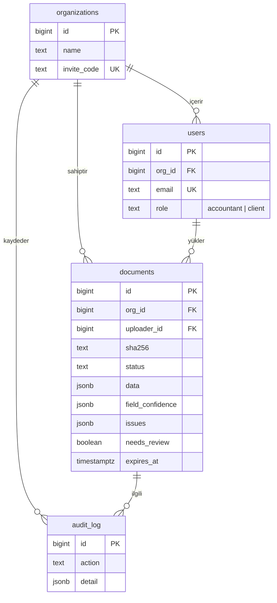

# database

PostgreSQL şeması ve yerel çalıştırma dosyaları.

## Çalıştırma

```bash
cp ../.env.example ../.env      # değerleri kendine göre değiştir
docker compose --env-file ../.env up -d
```

Şema ilk açılışta `schema.sql` ile otomatik yüklenir. Kullanıcı adı ve şifre repoda tutulmaz, `.env` dosyasından okunur.

## Veri modeli



## Tasarım kararları

- **Roller:** `accountant` (muhasebeci) bürosundaki tüm belgeleri görür ve onaylar; `client` (müşteri) yalnızca kendi yüklediklerini görür. Müşteri, büronun `invite_code` değeriyle kayıt olur.
- **Tekrar önleme:** `(org_id, sha256)` benzersizdir, aynı dosya iki kez yüklenemez. Aynı satıcı VKN + fatura no tekrarı API'de uyarı olarak işaretlenir (`ix_documents_invoice_key`).
- **KVKK:** `expires_at` ile dosya saklama süresi sınırlanır. Süre dolunca dosya silinir, çıkarılan veri kalır (`retention.sql`).
- **JSONB:** Fatura alanları ve güven skorları esnek tutulur, şema değişikliği gerektirmeden alan eklenebilir.

## Not

API geliştirme ve testlerde SQLite kullanır ve tabloları `api/app/models.py` üzerinden kendisi oluşturur. `schema.sql` üretim (PostgreSQL) içindir ve modellerle aynı yapıdadır. Bir modeli değiştirirsen bu dosyayı da güncelle.
